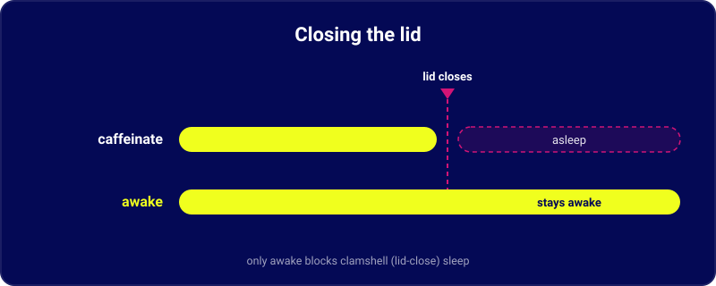

<div align="center">

# awake

*Keep your Mac awake without a password. Optional lid-close support.*

[](LICENSE)
[](https://github.com/dancumberland/awake/actions/workflows/ci.yml)
[](https://github.com/dancumberland/homebrew-awake)


</div>

## Why this exists

`caffeinate` is the macOS command for keeping a Mac awake while it sits idle. `awake` wraps it with a timer, survives closing the terminal, and can optionally keep the Mac running when you close the lid. It also watches for the lid to reopen and automatically restores the built-in microphone if macOS fails to bring it back.



The lid-close behavior shown above requires the `lid` option, such as `awake 1 lid` or `awake 1 unlock lid`.

## Install

Homebrew:

```sh
brew tap dancumberland/awake
brew trust dancumberland/awake
brew install awake
```

(Recent Homebrew requires trusting a tap before it will load formulae from it — that's the `brew trust` line, not an optional step.)

For an existing Homebrew installation:

```sh
brew update
brew upgrade awake
```

Or run the standalone installer, which installs `awake` in `/usr/local/bin` and its optional setup files in `/usr/local/libexec/awake`:

```sh
curl -fsSL https://raw.githubusercontent.com/dancumberland/awake/master/install.sh | bash
```

## Quick start

```sh
awake 1             # Keep the Mac awake for 1 hour; no password
awake 1 unlock      # Also prevent idle locking; no password, lid open
awake setup         # Optional: enter your Mac password once
awake 1 unlock lid  # Closed-lid mode; password-free after setup
awake off           # Stop early and restore normal behavior
```

Plain `awake` lists common durations and accepts inputs such as `1 unlock` or `1 unlock lid`. `.5` means 30 minutes; `2`, `8`, and `24` mean hours.

Upgrading from v3: plain `awake` no longer suppresses lid sleep. Add `lid` to preserve that behavior. After installing this release, `awake --version` should print `awake 4.1.0`.

## Optional one-time setup for password-free lid mode

After installing with Homebrew, the standalone installer, or a source checkout, run:

```sh
awake setup             # Enter your Mac password once
awake helper-status     # Verify the installed helper
awake 1 unlock lid      # Future runs do not ask for a password
```

Setup installs a root-owned fixed-function helper, a narrow sudo rule for the account that runs setup, and a root recovery LaunchDaemon. The grant permits only starting a 1–86400 second session, stopping that account’s session, and reading helper status. It does not grant arbitrary commands or direct password-free `pmset` access. The helper ignores shell startup environment code, uses fixed system executables, and keeps its lease state in a root-only directory.

Installed paths:

- `/Library/PrivilegedHelperTools/com.dancumberland.awake-lid`
- `/private/etc/sudoers.d/awake-lid`
- `/Library/LaunchDaemons/com.dancumberland.awake-lid-watchdog.plist`
- `/var/db/com.dancumberland.awake-lid/` (protected state and diagnostic receipts)

The installer validates sudo/plist syntax, checks real timed expiry, then kills its own test worker and verifies scheduled recovery before reporting success. A separate root watchdog restores sleep after a dead, expired, or previous-boot guard; failures retain state for retry. Password-free lid sessions are limited to 24 hours. The guard retains the existing conditional microphone recovery after a lid reopen.

Remove the grant and installed components with:

```sh
awake uninstall-helper  # One admin authentication; restores sleep first
```

Version 4.1.0 bundles the setup files in both installation methods. Stop an existing privileged sleep override with `awake off` before first-time setup. Upgrading the package updates the command and setup files; it does not silently replace an already-installed root helper or alter its grant. If `awake setup` reports that this account is already configured, no repeat authentication is needed. To replace the installed helper itself, uninstall it first, then run setup again.

## Usage

| Command | What it does |
| --- | --- |
| `awake` | Prompt for how many hours to stay awake |
| `awake 1 unlock` | Stay awake and pause idle locking for 1 hour (keep the lid open) |
| `awake unlock` | Prompt for hours with idle-lock prevention selected |
| `awake 1` | Stay awake for 1 hour, no admin password |
| `awake 1 lid` | Also suppress lid-close sleep; password-free after setup |
| `awake setup` | Install the optional narrow helper with one admin authentication |
| `awake helper-status` | Check the installed helper without a password prompt |
| `awake uninstall-helper` | Restore sleep and remove the helper/grant (admin required) |
| `awake 1 unlock lid` | Combine idle-lock prevention and lid-sleep suppression |
| `awake .5` | Stay awake for 30 minutes, no admin password |
| `awake 24` | Stay awake for a full day, no admin password |
| `awake off` | Let the Mac sleep normally again, including on a lid close |
| `awake status` | Show how much awake-time is left |

`awake --version` prints the version. `awake -h`, `awake --help`, or `awake help` print usage.

A session survives closing the terminal. The process is nohup'd and reparents to launchd, so it keeps running until the timer ends or you run `awake off`.

### Optional idle-lock prevention

Run `awake 1 unlock`, or type `1 unlock` when plain `awake` asks for a duration. For laptop-only closed-lid GUI work, add `lid`: `awake 1 unlock lid`. `awake unlock 1` also works. The prompt shows common durations: `.5` for 30 minutes, `1` for an hour, `2`, `8`, and `24`.

Unlock mode temporarily sets the current host’s screen-saver idle timeout to zero. A detached guard restores the exact previous timeout (or removes the override if it was originally absent) when time expires, `awake off` runs, another session replaces it, or its caffeinate worker exits. It preserves a different timeout you set yourself during the session. Password requirements are never changed.

Start with the Mac unlocked. The password-free `unlock` mode leaves lid sleep under macOS control; keep the lid open unless using closed-display mode with an external display. For the laptop alone, combine `unlock lid` as described below. Unlock prevents ordinary idle locking; it does not enter passwords, undo a manual lock, or override managed security policies. Your screen remains accessible while the mode is active.

A temporary per-user LaunchAgent independently checks for an ended or crashed unlock guard every five seconds and after login. It restores the saved timeout after a forcibly killed guard or reboot, retries restoration errors, and removes its job when cleanup succeeds. macOS may delay its dispatch; it cannot run while the Mac is off or before login. Unlock mode refuses to start unless this recovery job is registered. `awake status` and `awake off` also provide immediate recovery. Recovery receipts are kept in `~/.cache/awake/unlock-recovery.log`.

### Password-free default and explicit lid mode

Normal `awake` and `awake 1 unlock` never request admin access. Keep the lid open. With an external display, power, and external input devices, macOS can provide closed-display operation itself without Awake changing the lid-sleep setting.

For the laptop alone, use `awake 1 lid` to preserve the previous system-awake behavior. This option asks for your Mac password unless the one-time helper setup is installed. `awake 1 unlock lid` combines it with idle-lock prevention, with native GUI control and screenshot capture verified during one short laptop-only physical test. Behavior can vary by hardware, apps, macOS version, and security policy, so verify the setup on your own Mac before relying on it. Awake does not bypass manual or lid-triggered locks or supply a virtual display.

If an older lid session left sleep disabled system-wide, an ordinary session stops with instructions for `awake off` rather than unexpectedly prompting for a password. Restoring that privileged setting can still require admin access.

macOS physically disables the built-in microphone and camera while the lid is shut. An external microphone can remain available in that state. When you reopen the lid, Awake gives macOS a few seconds to return the built-in mic. If it stays missing, Awake restarts the Mac audio service automatically.

## What it does with `sudo`, exactly

Only explicit `lid` mode changes a systemwide setting that macOS only lets root change. That mode runs these two commands as root:

- `pmset -a disablesleep 1` when a session starts, to block clamshell sleep.
- `pmset -a disablesleep 0` when the session ends or the timer runs out, to restore normal sleep.

If the built-in mic fails to return after the lid opens, the same root-owned session guard runs `killall coreaudiod` once. macOS relaunches that audio service automatically.

That covers the entire use of root. The sleep setting applies to the whole system, so explicit lid mode requires either per-session admin authentication or the optional narrow helper grant.

In lid mode, you can decline the password prompt. `awake` falls back to lid-open protection. Nothing fails or crashes, and closing the lid lets the Mac sleep.

## Battery

> [!WARNING]
> With the lid closed, the Mac runs at full power with the screen off. That drains the battery faster than sleep does. Plug in for long sessions.

## Built-in microphone and camera

While the lid is closed, macOS turns off the built-in microphone and the built-in camera. They disappear from the device list in System Settings and in apps like Zoom. This is macOS behavior in clamshell mode, not something `awake` does — `awake` uses `caffeinate` and `pmset` for sleep prevention. Optional unlock mode also temporarily changes the screen-saver idle timeout.

Opening the lid usually brings both devices back. Sometimes the Mac audio service doesn't re-register the microphone, and it stays missing.

In explicit `lid` mode, Awake checks automatically. When that session starts, it records whether the Mac has a built-in microphone. The root-owned lid guard then watches for the lid to reopen, waits briefly, and restarts the audio service only when the built-in mic remains missing.

`awake off` and `awake status` retain a fallback warning if automatic recovery could not run:

```
🎙  Your built-in microphone hasn't come back. macOS turns it off while the lid
    is closed, and sometimes the audio daemon doesn't re-register it on the way
    back. Restart the daemon and it reappears:

        sudo killall coreaudiod
```

The audio service relaunches within a second or two. Restarting it briefly interrupts other Mac audio, so Awake does this only after a detected lid reopen and a failed microphone check. It stays quiet on Macs with no built-in microphone, while the lid remains closed, and when the microphone returns normally.

## Uninstall

Stop any active session first. If you enabled the optional root helper, remove it before removing the command:

```sh
awake off
awake uninstall-helper  # Only if configured; one admin authentication
```

Homebrew:

```sh
brew uninstall awake
```

Standalone installer (default prefix; adjust paths for a custom `AWAKE_INSTALL_PREFIX`):

```sh
sudo rm -f /usr/local/bin/awake
sudo rm -f /usr/local/libexec/awake/awake-lid-helper /usr/local/libexec/awake/setup-lid-helper.sh
sudo rmdir /usr/local/libexec/awake
```

Successful cleanup restores normal sleep and the previous screen-saver timeout. The per-user unlock recovery job removes itself after restoration. If restoration fails, keep Awake installed until `awake off` succeeds. The optional helper's uninstall removes its sudo grant, root job, and executable; protected diagnostic state is retained.

---


Built by Dan Cumberland. More at [dancumberlandlabs.com](https://dancumberlandlabs.com).

<br clear="left" />
